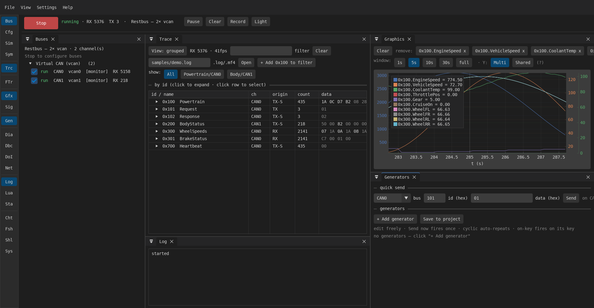
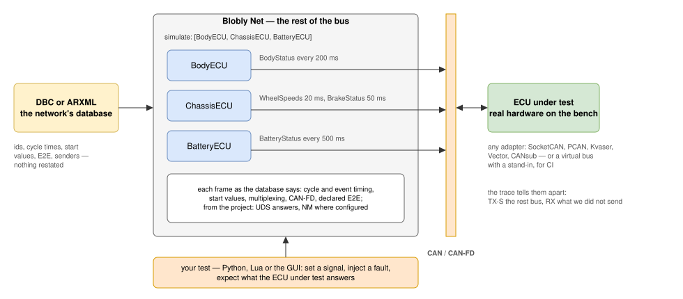
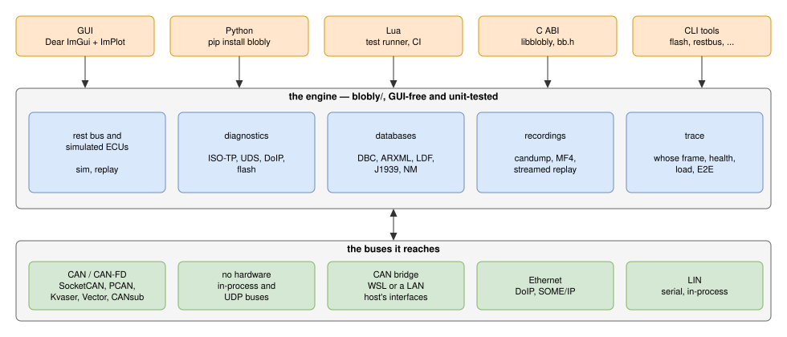
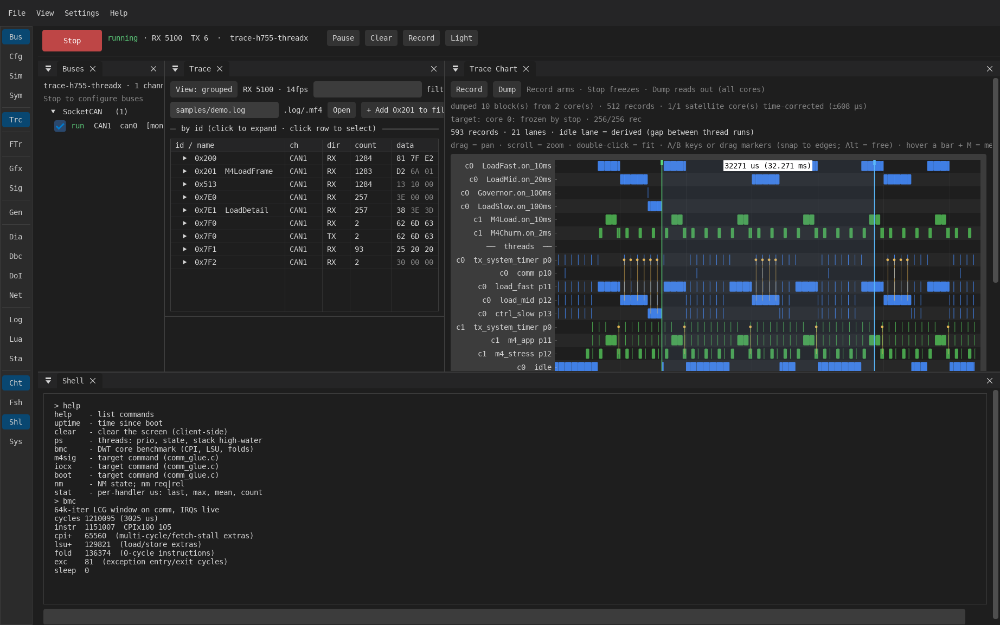

<h1><picture>
  <source media="(prefers-color-scheme: dark)" srcset="docs/logo-dark.png">
  
</picture></h1>

**An open-source automotive bus tester for CAN, CAN-FD, LIN, DoIP and SOME/IP.** Simulate the rest
of the vehicle around the ECU on your bench, straight from its DBC or ARXML. Watch and decode the
traffic, run UDS diagnostics, replay real recordings, and script all of it from Python, Lua or C.
Use the GUI, or run it headless in CI.

It needs no hardware to start: the simulated ECUs run in-process, on Linux and Windows. When the
bench is ready, the same project drives PEAK, Kvaser, Vector and CSS Electronics CANsub adapters
and any SocketCAN interface. MIT licensed.



*Two virtual CAN buses (`projects/restbus-2vcan.blobnet`). The **origin** column says who sent
each frame: `TX-S` is the simulated rest bus, `TX` is the tester, `RX` is everyone else. On a
bench, `RX` is the ECU under test.*

## Why Blobly Net

- **A rest bus from the database, in one line.** Name the nodes to simulate and every one of
  them sends what the DBC or ARXML says it sends, at the database's timing, with E2E counters and
  CRCs stamped per frame. No recording and no hand-written frames.
- **No hardware needed to start.** Simulated ECUs, UDS servers, DoIP entities and LIN nodes run
  in-process. The same project drives a real bench by changing an interface string.
- **The adapters you already have.** PCAN, Kvaser and Vector on Windows, any SocketCAN adapter
  on Linux, and a CANsub from either, all with CAN-FD. Each vendor backend is verified by hand on
  real hardware.
- **Python, Lua and C over one engine.** A typed Python package with a pytest plugin, a Lua test
  runner with JSON reports and hard timeouts, and a C ABI for any other language. The GUI uses the
  same engine, so a script sees what the GUI sees.
- **Diagnostics that say what went wrong.** One UDS client over CAN and DoIP: answers matched to
  their request, `0x78` waited out with the ECU's own P2*, DTCs decoded with their snapshots and
  extended data, and a negative response, a timeout and a dead adapter kept apart.
- **Real recordings as a rest bus too.** Replay a capture with the ECU under test removed by DBC
  sender, several buses on one clock, and MF4 files far larger than RAM streamed from disk.
- **You know whose frame it is.** The trace tells your own traffic (`TX`, `TX-S`) from the ECU's
  (`RX`) by matching what comes back against what this process sent.
- **Listen-only means silent.** On PCAN, Kvaser, Vector and CANsub the controller stops
  acknowledging frames, and every part of the app, scripts included, is refused a send on that
  wire.
- **Readers that say what they skipped.** Every database reader lists what it did not use, and
  the ARXML, LDF and ODX readers refuse a malformed value instead of reading it as 0.

## Rest-bus simulation



Put the network's database on the bus the ECU sits on, and name every node except the ECU under
test:

```yaml
buses:
  - name: CAN1
    adapter: socketcan                    # or pcan / kvaser / vector / cansub, or virtual for no hardware
    address: can0
    databases:
      - dbc/vehicle.dbc                   # or "vehicle.arxml#BodyCAN"
    simulate: [BodyECU, ChassisECU, BatteryECU]
```

Each simulated node then sends what the database gives it:

- **Cyclic messages** at `GenMsgCycleTime`, after `GenMsgStartDelayTime`; **event and mixed
  messages** when a value changes, with their repetitions, fast cycle and minimum gap.
- **Signals** at their start values, multiplexed pages and CAN-FD frames as declared.
- **E2E**: AUTOSAR Profile 1 and Profile 5 counters and CRCs, stamped fresh per frame from the
  database's declarations.

And from the project: a UDS server on the bus (or one per simulated ECU, each with its own DIDs
and DTCs), a DoIP entity, and network-management announcements where the NM cluster is configured.

From an **AUTOSAR ARXML** (one file, a set of files, or an ExtractEditor project),
**Import ARXML…** builds the channels: you tick the ECUs under test, and every other ECU that
sends on the cluster goes into the rest bus. The OEM's file stays the source of truth: nothing is converted, and a reissued extract
is simply read again.

Then make it behave: give a signal a waveform (sine, sawtooth, counter, staircase), set one value
live from a test (the CRC is computed over it, so the frame stays valid), or inject a fault
(drop a message, corrupt its CRC, freeze its counter, send an out-of-range value). The GUI and
the headless runner build the rest bus with the same code, so a rest bus in CI behaves like the
one on your desk.

The full walkthrough, from the database or from a recording, is
**[rest_bus.md](docs/rest_bus.md)**.

## Quick start

Three ways in, none of them needs hardware.

**1. The GUI with the simulation demo.** Download a [release](../../releases), unpack it and run
`blobly_net` (`blobly_net.exe` on Windows). Open `projects/sim-demo.blobnet`, which has two CAN
buses and a DoIP endpoint with simulated ECUs, and press **Start**. From a source checkout on
Linux:

```sh
scripts/setup_env.sh      # once: the pinned V toolchain and the native dependencies
scripts/run_gui.sh        # build and run the GUI
```

**2. Python.** The engine inside your own process, on Linux x86_64 and Windows x64:

```python
import blobly

blobly.init()                                                  # load the engine, on the main thread
with blobly.Project("projects/sim-demo.blobnet") as net:       # loaded and started; stopped at the end
    can1 = net.channels.CAN1
    can1.send(0x101, b"\x05")                                  # sim-demo's SUT answers with 0x102
    answer = can1.expect(0x102, timeout_ms=1000)               # every wait is bounded: blobly.Timeout after a second
    print("answer:", answer)                                   # Frame(0x102 [06])
```

Run it from a source checkout ([from a source checkout](docs/scripting_python.md#from-a-source-checkout))
or a release folder, so the project path resolves. `pip install blobly` installs the package from
PyPI; the version there today predates `expect` and most of the API below, which ship with the
next release. The [Python guide](docs/scripting_python.md) and the
[examples](python/examples/README.md) go on from here.

**3. A Lua test suite.** From a source checkout, headless, with a non-zero exit status on failure:

```sh
scripts/runtests.sh tests/diag_basic.lua tests/bus_signals.lua
```

The Lua API is in [scripting.md](docs/scripting.md).

## What it does



### Buses and hardware

- **CAN and CAN-FD** on SocketCAN (Linux), PCAN, Kvaser and Vector XL (Windows), and CANsub
  (Linux and Windows, no driver: it is a USB network adapter).
- **CAN-FD from the address** on PCAN, Kvaser, Vector and CANsub: a data rate
  (`@500000/2000000`) opens an FD channel. On SocketCAN, FD is the interface's own setting. A
  classic channel refuses an FD frame instead of cutting it short.
- **Software buses** `inproc:` and `udp:` carry CAN-FD on every OS and refuse frames no real
  controller could send, so a test that passes there does not fail on a bench for that reason.
- **CAN bridge**: `canbridge` offers a Linux host's CAN interfaces over TCP. The Windows app
  starts it in WSL with one click and uses WSL's `vcan`s; a LAN host can dial in too. The
  [protocol](docs/bridge_protocol.md) is public, so a board can implement it.
- **Bus health**: ok, warning, error-passive and BUS-OFF per wire, coloured in the Buses panel,
  told in the Log, and the worst wire's state on the toolbar. Scripts read the controller's
  TEC/REC where the backend reports them.
- **Bus load**: a 60-second strip per wire and the busiest wire on the toolbar.
- **Lost frames are counted**: dropped, controller-error and undecodable records per wire, and
  `last RX` says how long another node has been silent.
- **Discover** lists what is attached (SocketCAN links, vendor channels, CANsub by mDNS, WSL and
  LAN bridges, DoIP entities) and adds it to the project. Vector channels are assigned there,
  without Vector Hardware Manager.
- **Ethernet**: DoIP and SOME/IP (send, call, listen, and a `someip` channel in the trace) over
  ordinary TCP/UDP sockets.

| adapter | Linux / WSL2 | Windows |
|---|---|---|
| **PEAK PCAN** | kernel `peak_usb`, SocketCAN `can0` | `pcan:PCAN_USBBUS1@500000`; FD verified on a bench, cross-vendor, at 1/2/4/8 Mbit/s |
| **Kvaser** | kernel `kvaser_usb`, SocketCAN `can0` | `kvaser:0@500000`; FD verified on a bench to an 8 Mbit/s data phase (FD arbitration 500k or 1M) |
| **Vector** (VN16xx) | no mainline driver | `vector:1@500000`; FD verified on a bench with a VN1630A to an 8 Mbit/s data phase; `,silent` for listen-only |
| **CSS CANsub** | `cansub:<device-id>/1@500000`, found by mDNS | the same string and code; verified on a bench with a CANsub.4, classic and 64-byte FD |

On Linux the kernel owns the adapter, so no vendor SDK is involved. On Windows the vendor's own
DLL is loaded at run time and nothing is bundled: PCAN and Kvaser come with the vendor's driver,
and Vector's `vxlapi64.dll` is the separate XL Driver Library download. Under WSL2, bind the USB
adapter with `usbipd-win` and attach it (`scripts/usbip.sh attach <busid>`); the WSL kernel needs
the CAN drivers. Details: [can_hardware.md](docs/can_hardware.md) and
[windows_can_hardware.md](docs/windows_can_hardware.md).

### Diagnostics

- **UDS client** (ISO 14229): sessions, DIDs, write, reset, clear and read DTCs, routines, IO
  control, memory, communication control, DTC setting, tester present and raw requests.
- **Answers matched to their request.** A late duplicate from a CAN retransmission is discarded,
  and `0x78` is waited out with the P2* the ECU announced.
- **Typed failures.** A negative response, a timeout, an expired `0x78` and a dead adapter are
  separate error types in Python and C, and separate messages in Lua.
- **DTCs as data**: J2012 names, each status bit by name, snapshots and extended data.
- **Functional addressing**: on CAN one request with an outcome per ECU; on DoIP a request to the
  functional address.
- **Security access** `0x27`, with the OEM's key algorithm plugged in as a function, and **`0x29`
  authentication** as blobly_emb serves it (ISO 14229-1 challenge-response with an Ed25519 key),
  from Lua, Python and C.
- **ISO-TP in software** on every adapter and OS: full flow control, messages past 4095 bytes,
  and CAN-FD frames up to 64 bytes.
- **DoIP tester** (ISO 13400): routing activation with named refusals, alive checks, discovery,
  and routing through a gateway to a node behind it.
- **Simulated DoIP entities** with a VIN and announcements; several on one PC.
- **Nodes and DIDs by name** from a blobly_emb `system.toml` or an ODX/PDX file, with values
  decoded through the description's layout ([odx.md](docs/odx.md)).
- **Diagnostics panel**: a held connection with keep-alive, DTC and DID tabs, a write dialog
  that states its session and unlock plan first, and a timed log of every exchange.
- **Copy as Lua** turns a session you clicked through into a runnable regression test.
- **Flashing** a blobly_emb bootloader from the GUI, `cmd/flash`, Lua, Python or C, with a
  simulated bootloader to rehearse against.

### Databases

- **DBC** parse, decode and encode: Intel and Motorola, signals up to 64 bits, multiplexing,
  value tables, extra transmitters, signal groups.
- **The DBC's send attributes drive the simulation**: cycle time, send type, repetitions, start
  values, CAN-FD format.
- **Canonical DBC writer**: a save puts the file in one deterministic order, so after the first
  save a git diff shows only real changes.
- **DBC editor** in the GUI: forms, a bit-layout grid, multiplexing, value tables. The trace
  decodes with your edits.
- **AUTOSAR ARXML 4.x** read natively, one database per CAN cluster, including systems spread
  over several files and ExtractEditor `.e3proj` projects. **Import ARXML** turns clusters into
  project channels.
- **`arxml2dbc`** exports a cluster as a DBC that records its source files, their hashes and
  whether the read was partial.
- **E2E declared in the DBC**: AUTOSAR Profile 1 and Profile 5, several protected windows per
  frame ([dbc_attributes.md](docs/dbc_attributes.md)).
- **J1939**: PGN and source address in the trace, BAM and RTS/CTS transfers rejoined and
  decoded, and address claims ([j1939.md](docs/j1939.md)).
- **Network management**: who keeps an AUTOSAR CanNm cluster awake, who woke it, and which
  declared nodes are missing ([nm.md](docs/nm.md)).
- **Recordings**: `candump` `.log` read and written with a TX/RX direction per line, and a
  native ASAM MDF4 (`.mf4`) reader.

### Simulation and replay

- **Rest bus from the database** ([above](#rest-bus-simulation), [rest_bus.md](docs/rest_bus.md)),
  with signal waveforms, live values from a test, E2E, network management and UDS servers.
- **Generators**: frames sent on a button, a key press or a cycle; **Quick Send** for one-off
  frames.
- **E2E checked**: a `verify:` block checks the ECU under test's counter and CRC, live and in
  recordings.
- **Fault injection**: drop, bad CRC, frozen counter, out of range, applied in the right order
  around E2E.
- **Rest bus from a recording** with the ECU under test removed by DBC sender (J1939 by PGN). A
  scan shows frame counts per node so you can pick it.
- **Multi-bus replay** from one clock, because a gateway polices the timing between buses.
- **Replay panel**: pause, seek, 0.25x to 4x speed, loop.
- **Large MF4 files stream**: a 397 MB file replays in 34 MB of memory, against 2.9 GB loaded
  ([streaming_replay.md](docs/streaming_replay.md)).
- **Demo projects** for simulation, the rest bus, DoIP, E2E, J1939, NM, LIN, ODX and replay, all
  driver-free.

### Scripting and automation

- **Python**: CPython 3.11+, no dependencies, fully typed. Frames, signals, UDS, DoIP, SOME/IP,
  flashing, J1939, NM, LIN, E2E, faults, generators, replay and recording
  ([scripting_python.md](docs/scripting_python.md)).
- **pytest plugin**: a started project, a fixture per channel and a `diag` client;
  `--blobly-interface=CAN1=vcan0` runs one suite on the simulation or on a bench.
- **Lua runner** (`cmd/script`): `--report` writes JSON, `--timeout` ends even an endless loop,
  and exit codes separate failed, refused, script error and timeout.
- **The same Lua scripts run in the GUI's Script panel** against a live measurement.
- **C ABI**: `libblobly` / `blobly.dll` with one header, `bb.h`, shipped in both release bundles.
- **VS Code as the console**: completion, breakpoints and the Debug Console against a live
  project ([vscode.md](docs/vscode.md)).
- **For AI agents**: bounded waits, typed errors and a guide, [agents.md](docs/agents.md).

Command-line tools run from a source checkout (`v -enable-globals run cmd/<tool>`):

| tool | what |
|---|---|
| `script` | the headless Lua test runner |
| `restbus` | replay a recording onto live buses with the ECU under test removed |
| `arxml2dbc` | export one ARXML CAN cluster as a DBC |
| `canbridge` | offer this host's CAN interfaces to Blobly Net elsewhere (shipped in the Windows bundle) |
| `lin_monitor` | watch or run a LIN bus through an LDF |
| `dbc_decode` / `mf4_dump` | decode one frame / summarise an MDF4 file |
| `project_scaffold` | turn the attached interfaces into a project's `channels:` block |
| `crosscheck`, `silentcheck`, `kvasercheck`, `vectorcheck` | check a bench with the same backend code the app uses |
| `flash` / `trace_dump` | flash a blobly_emb bootloader / dump a blobly_emb target's trace |

### GUI and analysis

- **Dockable panels** (Dear ImGui and ImPlot): arrange them, or tear one out onto another
  monitor.
- **Trace**: chronological or grouped by id with cycle time, decoded signals, flags for FD, BRS,
  RTR and J1939 transfers, filters, and recording.
- **Signals and Graphics**: live plots with up to three Y axes and a hover readout.
- **Configuration**: a form for the buses, and a File tab that edits the whole `.blobnet` as text
  with its comments kept.
- **Network**, **Network Management**, **Statistics** and **Performance** panels.
- **Help ▸ Copy diagnostics** puts the version, OS, project and the last Log lines on the
  clipboard for an issue report.
- **Offline help**: the docs ship with the app and open in the browser.

### LIN

- **Its own bus type**: master, slave and monitor roles, schedule tables, wakeup and sleep,
  diagnostic frames, injected faults ([lin.md](docs/lin.md)).
- **Backends**: `inproc:` on every OS, with bit-wise arbitration; on Linux `tty:` (a UART and a
  LIN transceiver, any rate including 10417) and `pty:` to link another program.
- **LDF reader** for LIN 1.3, 2.0, 2.1 and 2.2A, cross-checked against ldfparser.
- **In projects, the GUI and scripts**: View ▸ LIN, LIN rows in the trace, and LIN from Lua,
  Python and C.
- Not yet: PEAK PLIN on Windows, LIN in recordings, and a bench check of `tty:` on a real
  transceiver.

## Works with blobly_emb

[**blobly_emb**](https://github.com/MartenH/blobly_emb) is the companion embedded stack: an
automotive ECU stack in V that runs on STM32 targets and on a PC. Blobly Net is its
integration-test driver, and the wire formats the two share (trace records, SOME/IP, DTC records)
are pinned by golden vectors on both sides. A simulated ECU can be built from a blobly_emb
`ecu.toml`, with its real DIDs, session and security gates. Tick **View ▸ blobly_emb panels** for
four more panels:

- **Trace Chart**: handler, thread and idle lanes per core from the target's trace rings, with
  both cores on one corrected timeline.
- **Shell**: a command line to the target over CAN or SOME/IP.
- **Flash**: firmware download to the blobly_emb bootloader.
- **System**: the network's `system.toml`, and **Simulate the rest**, which simulates every other
  node on the selected ECU's buses.



*A dual-core STM32H755 traced live over SocketCAN, both cores on one timeline, with the Shell
panel talking to the target below.*

## Get it

- **[Releases](../../releases)**: a Linux `tar.gz` and a self-contained Windows `zip` per
  version, with demo projects, DBCs, sample logs and the docs.
- **Python**: `pip install blobly`, wheels for Linux x86_64 and Windows x64.
- **Linux**: Ubuntu 24.04 or newer (or a glibc as new), plus
  `sudo apt install libglfw3 libfreetype6 libgl1`.
- **Windows**: unzip and run.
- **macOS** (Apple Silicon): from source, with the software buses, the bridge and CANsub.

This page describes `main`. Features landed since the newest release ship with the next one, and
CI builds of `main` are available in between ([building.md](docs/building.md#between-releases)).

## Build from source

On Linux or WSL2 (Ubuntu 24.04):

```sh
scripts/setup_env.sh      # V at the pinned commit, GLFW, FreeType, can-utils; builds and tests
scripts/run_gui.sh        # build and run the GUI
```

Windows (MSYS2), macOS, the dependency lists and between-release builds are in
[building.md](docs/building.md). The CI workflows ([`ci.yml`](.github/workflows/ci.yml),
[`windows.yml`](.github/workflows/windows.yml)) build on a clean runner for every pull request
and every push to `main`, and are the reference recipe.

## How it's tested

The protocol engine (`blobly/`) imports no GUI code, so it is tested on its own.

**In CI, on every pull request and push to `main`:**

| what | how much |
|---|---|
| Unit tests across 30 engine modules | 230 test files, over 2,700 test functions and 11,000 assertions |
| Golden byte vectors | wire formats pinned to exact bytes, including CANsub's 20 published vendor vectors, E2E vectors from the independent autosar-e2e library, and the formats shared with blobly_emb |
| Headless Lua suites | every file in `tests/`, run against simulated ECUs, UDS servers, DoIP entities and LIN nodes |
| Python package | 35 test files, about 950 test cases, every example script and every Python block in the guides; CPython 3.12 on Linux and Windows from source and from the installed wheel, 3.11 on Linux from source; `pyright --verifytypes` at 100% |
| C ABI | C and ctypes smokes on Linux and Windows |
| GUI | built on Linux and Windows; the Linux release build runs sim-demo for 240 frames on Xvfb |
| Command-line tools | every tool type-checked for Linux, Windows and macOS |

**By hand:**

- **Hardware**: PCAN, Kvaser, Vector and CANsub on real buses, each with a dated bench record in
  [windows_can_hardware.md](docs/windows_can_hardware.md); target features on STM32 boards
  running blobly_emb.
- **Independent oracles** ([`sut/`](sut/README.md)): an independent DBC decoder, cantools
  (ARXML), asammdf (MDF4), ldfparser (LDF) and autosar-e2e. The LDF and E2E answers are also
  frozen into CI as golden vectors.

**What CI does not cover:** no CI runner has a CAN adapter or a `vcan`, so hardware results are
by hand. GUI panels have no automated behaviour tests. Windows runs the ISO-TP module and the
Python suite, not the full unit suite. macOS is type-checked only.

## Docs

**Using it**
- [rest_bus.md](docs/rest_bus.md): rest-bus simulation, from the database or from a recording
- [simulation.md](docs/simulation.md): simulated ECUs, generators, E2E, faults and replay in full
- [scripting_python.md](docs/scripting_python.md): the engine from Python
- [scripting.md](docs/scripting.md): Lua scripting and the headless runner
- [vscode.md](docs/vscode.md): VS Code as the console
- [agents.md](docs/agents.md): for an AI agent driving Blobly Net
- [project_editing.md](docs/project_editing.md): projects, buses and channels
- [bus_config_dialog.md](docs/bus_config_dialog.md): bus and hardware configuration
- [dbc_editor.md](docs/dbc_editor.md): the DBC editor
- [dbc_attributes.md](docs/dbc_attributes.md): the DBC attributes Blobly Net reads and adds
- [doip.md](docs/doip.md): DoIP
- [security_access.md](docs/security_access.md): security access and authentication
- [odx.md](docs/odx.md): ODX/PDX diagnostic descriptions
- [j1939.md](docs/j1939.md): J1939
- [nm.md](docs/nm.md): the Network Management panel
- [lin.md](docs/lin.md): LIN
- [wsl_bridge.md](docs/wsl_bridge.md): the CAN bridge to WSL and the LAN
- [bridge_protocol.md](docs/bridge_protocol.md): the bridge's wire format

**Platform and troubleshooting**
- [building.md](docs/building.md): building from source on Linux, Windows and macOS
- [can_hardware.md](docs/can_hardware.md): real CAN adapters
- [windows_can_hardware.md](docs/windows_can_hardware.md): PCAN, Kvaser, Vector and CANsub, and
  what is verified on hardware
- [known_issues.md](docs/known_issues.md): known issues

**Design**
- [data_path.md](docs/data_path.md): every carrier from the wire to the panels, scripts and files
- [ethernet_architecture.md](docs/ethernet_architecture.md): DoIP and SOME/IP
- [simulation_architecture.md](docs/simulation_architecture.md): simulated ECUs
- [one_reader_per_wire.md](docs/one_reader_per_wire.md): sharing one adapter channel
- [streaming_replay.md](docs/streaming_replay.md): replaying recordings larger than memory
- [blobly_emb_synergies.md](docs/blobly_emb_synergies.md): the tester and the ECU stack together

**Project**
- [ROADMAP.md](ROADMAP.md): what is next and what is out of scope
- [CONTRIBUTING.md](CONTRIBUTING.md): issues and pull requests welcome
- [releasing.md](docs/releasing.md): how a release is cut
- [CLAUDE.md](CLAUDE.md): architecture and decisions, the guide for coding agents

## License

MIT, see [LICENSE](LICENSE).
