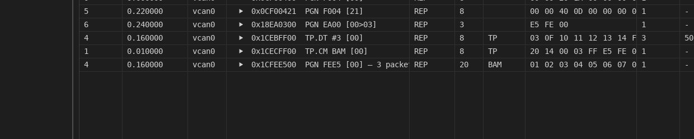

# J1939 — what the trace understands, and what it does not

SAE J1939 is the protocol family on trucks, buses and off-highway machines: 29-bit CAN ids
carrying a **parameter group number** (PGN) and a **source address** (SA), with anything longer
than 8 bytes split over the **transport protocol** (BAM or RTS/CTS) and every node announcing
its identity by **address claim**. Blobly Net reads all of that. Of the transport protocol it
also sends both forms and answers a connection aimed at a node it plays; it claims no address
and answers no Request.

## Turning it on

The Trace panel has a **J1939** button with three states. **auto** reads each wire as its own
databases declare: on where one of them declares J1939 messages (`BA_ "VFrameFormat" … J1939PG`,
per message or as the file-wide default, which the CSS and Vector J1939 databases carry), off
otherwise — so a project with a truck bus beside a 29-bit diagnostic bus reads each correctly.
**on** and **off** override every wire, until the next project load (a Save or a Configuration
edit does not touch them); changing it drops what the reading had built — sessions, the address
directory, cached names — and re-imports a recording on screen under the new reading. It is a reading the operator chooses, not a fact the app infers: a
29-bit id alone does not say which protocol it belongs to — UDS over 29-bit ids (`0x18DAxxyy`) is
shaped exactly like a PDU1 parameter group — so reading every extended id as PGN/SA would put a
confident wrong answer in every row of a bus that is not J1939.

### A wire whose database does not say

`VFrameFormat` is a Vector attribute, and most J1939 databases were written without it — so
**auto** reads nothing on a perfectly ordinary truck bus, and **on** is the wrong instrument,
since it overrides every wire at once. Tick **J1939** on the channel instead (or write
`j1939: true` on it in the project file), and that ONE wire reads as J1939 in auto:

```yaml
channels:
  - name: J1939
    interface: can0
    bitrate: 250000
    j1939: true
```

It counts exactly as a database's declaration does, so a bench with a truck bus and an ordinary
CAN bus beside it reads each correctly with no override in force. A project that uses it is
written as schema **v6**: a build that predates the key drops it on its next save, and a
declaration lost on a rewrite is worth the warning an older version-aware build then gives.

### A recording answers for itself

A capture somebody sends you has no project row to ask, so it is read as J1939 when **the file
proves it**: a well-formed transport announcement — a BAM or an RTS whose size, packet count,
destination and group number all agree — is not something a bus that is not J1939 produces by
accident. Evidence beats SILENCE, never a statement: it decides for every recorded bus nothing
in the project identified, including the ordinary case of one CAN row and one recorded bus
whose label matches nothing, where the recording is placed on that row by arithmetic. A bus
whose label does name a configured wire keeps that wire's reading. The same rule the reassembler admits announcements by, so a file that answers yes is
one it can then read. A J1939 recording carrying no multi-packet transfer is simply not
recognised: a missing reading, never a wrong one. The panel's **on** and **off** still override
it, as they override every wire.

Try it with no hardware and no database at all:

```sh
BLOBLY_PROJECT=projects/j1939-demo.blobnet ./scripts/run_gui.sh
# Trace ▸ Open Recording ▸ samples/j1939-bam.log
```



*One parameter group from two senders, a request addressed to one node, an address claim, the
frames of a multi-packet transfer, and the 20-byte message they add up to — rejoined as a row
of its own and flagged `TP`.*

## What you see

**The name column carries the reading.** A 29-bit row reads `EEC1  PGN 0xF004 SA 0x00 Engine`:
the database's name where there is one (matched by PGN, so the source address the DBC spelled
does not matter), then the PGN, the source address, the destination for a PDU1 message
(`PGN 0xEA00 DA 0x00 SA 0xF9`), and the node's name where the bus has said it. The id column
keeps the raw hex, which is what a candump line or a DBC entry compares against. The filter box
searches the reading too: `sa 0x0b` shows one node's traffic. (The DBC name by PGN predates this
and is a decode choice, not a claim: `lookup_frame` has matched any extended frame to a message
sharing its PGN since #95, because naming a frame you already have is not the same as attributing
it — which is why the rest-bus subtraction below insists on the declaration and this column does not.)

**A multi-packet message is a row of its own.** When a BAM or RTS/CTS transfer completes, the
trace gets one row with flags `TP`, the whole parameter group as its data (up to 1785 bytes; the
cell and the filter show and search the first 64 and say how many more) and the id a single frame
of that PGN would have carried — so the grouped view decodes its signals against the same `BO_` a
short message uses, and the reading says `· 3 packets BAM`. The packets themselves stay in the
trace as the frames they were; the row is added, nothing is hidden. A transfer that does not
complete is said in the Log instead of vanishing: a dropped packet (`sequence gap: got packet 3,
expected 2`), an abort with its reason (ending only the transfer whose PGN it names, and where it
declares its sender's role — originator or responder — the transfer in that direction, since two
nodes can be mid-transfer in both directions with the same group), a sender that stopped (T1, 750 ms, between a BAM's
packets; a connection gets T3, 1250 ms, from its last frame in either direction, since its
receiver may take that long to say "go on" or may hold it with CTS), an announcement whose size
and packet count disagree, a control frame with a field J1939-21 does not permit — twenty per
wire per run, then one line saying it stopped. Data frames of a transfer already in progress when
you started listening are the normal case of attaching to a running bus; they are said once per
wire and counted after. A recording that ends mid-transfer, inside the wait that would have timed
it out, says so (`after packet 2 of 3; the recording ends`) rather than leaving the packets with
no message and no reason.

**Every control-frame field is checked against one table** (`blobly/j1939/cm_fields.v`):
for each of RTS, CTS, EndOfMsgACK, BAM and Abort, every byte and what J1939-21 lets it hold.
A field the reader USES — the size (9..1785), the packet count (2..255), the 18-bit PGN and,
on every control frame, a PDU1 group's zero low byte, and the BAM's reserved byte that marks a
real announcement — holding a value the standard does not permit makes the frame one `malformed` line, acted on by nothing:
a refused announcement opens no transfer (and still ends the pair's previous one), a refused CTS
keeps nothing alive, a refused acknowledgement or abort ends nothing — in the trace and in the
rest-bus walk alike, since both ask the same check. A RESERVED byte of a CTS, an acknowledgement
or an abort that is not the 0xFF the standard fixes (an Abort's byte 2 in either edition: all
0xFF, or the abort's role in its low two bits, the reserved role code 10 read as none), and an
RTS's packets-per-CTS below the standard's 2 (a field this listener never uses), is only said — once per wire, since an ECU that
pads with 0x00 does it on every frame — and the frame is read as ever: refusing such an abort
would turn it into a timeout and replay the excluded node's own abort back at it. What a field
may hold given ANOTHER field or the open transfer (a packet count against the size, a CTS's
packet against the transfer's count) is checked beside the reader that knows both. Abort reasons
1–9 are named, 250 is "any other reason", 251–255 are J1939-71's special values
rather than reasons.

**A rejoined message decodes only where its definitions agree.** The database name and signals
come from the message the wire's databases define at exactly that PGN and source address, else
by PGN alone. Where those candidates have different layouts — two definitions of the pair in
one file, two files on the wire each defining it once, differently, or an unspelled address
whose PGN is defined differently per source — nothing is decoded and the Log says why, once
per wire, group and source: the first definition would be an arbitrary schema shown as values.
Where any candidate is declared J1939 (`VFrameFormat`), only the declared ones are compared — an
undeclared 29-bit message at the same id in another file is a coincidence, not a definition.

**Address claims name the nodes.** An Address Claimed frame (PGN 0xEE00) puts its NAME in the
Log — `SA 0x00 claimed by NAME 0x…: Engine, On-Highway, vehicle system 0.0, manufacturer 12,
identity 1234` — and from then on every row from that address carries the name. Contention is
followed by J1939-81's rule (the lower NAME keeps the address), a NAME moving leaves its old
address, and a Cannot Claim releases it. The function names are the 32 global ones every
industry group shares; anything else reads as its number rather than a guess. Nodes claim at
power-up, so a bench that joined late sees no names until something asks: a Request for
Address Claimed on the bus, which this tool does not send. The directory resets with the trace's
rows (Clear, Load, a project load) and at Start — a live run must never wear names learned from
a loaded file.

**A loaded recording gets the same treatment**, on the file's own clock: one listener per
recorded bus, rejoined messages and claims from the whole file, filed under the recording's own
bus labels, and each bus read as J1939 according to the configured channel its label NAMES.
Where the label names none, the bus is placed by fallback rather than identified — on the
project's one CAN wire when the file has one bus, and nowhere at all when either side is
ambiguous (a multi-bus file, or a label two configured wires answer to), since guessing would
read a diagnostic bus as a truck bus. A placement is not an answer about the bus, so **the
file's own evidence overrides one** and the section above is what decides; force **on** to read
a file that proves nothing. An identified bus keeps its wire's reading, because there somebody
did say. One consequence: the `idx` column of an
import equals the file's frame number only until the first rejoined message, whose row takes a
number of its own; the toast says how many frames and how many rejoined messages the table holds.

## Rest-bus replay and the source address

A J1939 database defines one `BO_` per PGN with a **placeholder source address** in the id, and a
recorded frame carries the real one, so keyed on the exact id the rest-bus subtraction
(`replay.exclude`, `cmd/restbus --exclude`) missed every frame of the bus and replayed the ECU
under test's own messages back at it. Now a message the database **declares** J1939 is matched by
PGN, and the report says how many frames that decided (`matched by J1939 PGN`). On a database
that does not declare it the exact-id rule stands — the file has not said the bus is J1939, and
on a 29-bit UDS bus a request and its response share a PGN, so matching by PGN would subtract the
tester's stimulus on the ECU's account — but the report names the coincidence, in the CLI, in the
Start notification and in the Configuration panel's preview: `N unknown frames share a PGN the
DBC defines but cannot decide by`. Declare the bus (`BA_DEF_DEF_ "VFrameFormat" "J1939PG";`) and
they are matched. **A multi-packet transfer is judged by its announcement**: the TP.CM and TP.DT
frames of an excluded node's 20-byte DM1 carry the transport protocol's PGNs, which no DBC
attributes, so they were replayed back at the SUT until the walk learned to follow the
announcement (`judged by their announcement` in the reports). The receiver's side of a
connection — CTS, the end-of-message ack — is nobody the database can name and is replayed as
unknown by construction (a DBC that happens to define TP.CM as a message changes nothing), as is
a transport-protocol frame no announcement accounts for; one more reason RTS/CTS replay is
open-loop. Two other cases cannot decide and count the
same way: two declared `BO_`
entries for one PGN naming different transmitters (two engines, each its own node — a frame from
a third source address is either's), and a declared message sharing its PGN with an undeclared
extended one (the frame is as much the undeclared one's neighbour). Such frames are replayed as
unknown.

## Sending a message longer than 8 bytes

A message its database declares J1939 (`VFrameFormat` `J1939PG`) of 9 to 1785 bytes, sent on a
row whose frames go out classic, goes out as the transport protocol's broadcast: one TP.CM BAM
to the global address, then its TP.DT packets numbered from 1, seven bytes each and the last
padded with 0xFF, from the message's own source address (the low byte of its DBC id) at priority
7, 50 ms apart — the shortest gap J1939-21 gives a BAM, counted from when the send before it returned. Every send path does it, through the one
segmenter in `blobly/j1939` (`message_frames`, `bam.v`): the simulated nodes, the generators, the
background senders (`send_cyclic`, one BAM a period) and a script's message send (Python
`Message.send`, Lua `bus.send_message`, C `bb_message_send`, which return once the last packet is
out; Ctrl-C ends Python's between packets). Every sender in the process keeps one broadcast in
progress per source address on a wire — a simulated node, two generators or a script sending from
one address take turns — and queues the next behind it, the address held until the last packet
is on the wire; a sender stalled past T1 (750 ms) loses its transfer, the rest of it unsent rather than
resumed without its announcement; a simulated node faster than its
transfers sends the latest of each message rather than a backlog, and a generator fires again
once its BAM is out. On an FD row the message is one CAN-FD frame, as before (J1939-22's transport is
not sent). In C, a message past 64 bytes is a `bb_payload` (`bb_encode_payload`,
`bb_e2e_stamp_payload`), since `bb_frame` holds 64.

```python
body = net.channels.J1939.messages.BodyStatus   # 20 bytes, PGN 0xFF10 from SA 0x21
body.send(Odometer=12345.6)                      # TP.CM BAM, then 3 TP.DT
body.send_cyclic(1000, Odometer=12345.6)         # one BAM a second
```

## A connection to one node (RTS/CTS)

A long message whose id addresses one node — a PDU1 group with a destination other than 0xFF,
such as `PropA_Cfg` in [`dbc/j1939_demo.dbc`](../dbc/j1939_demo.dbc), PGN 0xEF00 from 0x21 to
0x00 — goes as a **connection** (`blobly/j1939/conn.v`): an RTS naming its size, packet count
and group (at most 8 packets per CTS, since a window is written back to back and a SocketCAN
interface queues ten frames), the packets each CTS from the destination clears — a
CTS of zero packets holds the sender, which waits J1939-21's T4 (1050 ms) for the next — and the
destination's end-of-message acknowledgement, after which the send has succeeded. An answer that
does not come within T3 (1250 ms, or the wait the script gives) aborts the connection (reason 3,
"a timeout occurred") and fails the send; an abort from the destination fails it with the
destination's reason. The same send paths do it as for a BAM: a script's message send (Python
`Message.send(..., timeout_ms=)` raising `blobly.Timeout` when no CTS comes, Lua
`bus.send_message(..., { timeout_ms = })`, C `bb_message_send`, each returning once the
acknowledgement is in), the background senders and the headless generators, which read the
answers from a handle of the connection's own so a script's reading of the channel misses
nothing; and a simulated node, whose engine opens the connection on its message's cycle (skipping
a cycle while the previous one is still going on), says once in the Log when one does not
complete, and aborts the ones still going on (reason 250) when the run stops. One connection from a source address to a destination runs at a time in the process.

The other side is answered too. A **simulated node answers an RTS aimed at any address its
J1939 messages are sent from** (the low byte of their DBC ids): a CTS for as many packets as the
RTS allows per CTS, the next CTS after each window, the end-of-message acknowledgement once the
last packet is in, and an abort when a packet comes out of sequence (reason 7) or the packets stop
(reason 3: T2, 1250 ms, after a CTS; T1, 750 ms, between packets). Between two nodes one
simulation plays the connection is carried at once, every frame still on the wire in order. A script answers as the node at
an address it names — Python `ch.j1939(address=0x00)`, Lua `j1939.answer(ch, 0x00)`, C
`bb_j1939_answer` — from the reads of the channel, so a connection is answered while the script
reads it; the message itself arrives through the listener as any other.
`projects/j1939-script.blobnet`'s `Conn` row simulates the demo's Engine (it sends EEC1 from
0x00), so a script on it sending `PropA_Cfg` by name gets its CTS and acknowledgement.

```python
cfg = net.channels.Conn.messages.PropA_Cfg       # 16 bytes, PGN 0xEF00 from 0x21 to 0x00
cfg.send(Mode=2, Setpoint=100.0, timeout_ms=3000) # RTS, CTS, 3 TP.DT, ack; Timeout when no CTS
```

## What it does not do

- **Rejoin our own transfers on a backend that does not echo.** A BAM this host replays is
  rejoined off its echo, so it shows as a `TP` row on SocketCAN, Vector, Kvaser, CANsub, the CAN
  bridge and the software buses; PCAN hands nothing back, so there the trace shows the packets we
  sent and no message.
- **Open a connection from a GUI generator.** A generator in the GUI fires frames from the GUI's
  generator loop, which reads nothing; a message to one node there is refused with a line in the
  Log. The headless runner's generators, the background senders and scripts send it.
- **Answer anything but a connection.** A simulated node sends its messages, BAMs and connections
  included, and answers an RTS aimed at its address, and nothing else: no reply to a Request, no
  address claim of its own. Replay is open-loop: a recorded RTS to a node that exists only in the
  file will stall unless a simulated node holds that address. BAM replays fine. Composing playback
  with reacting nodes is its own piece of work (#171's thread).
- **Read J1939 SPNs beyond what the DBC says.** Signals come from the database; there is no
  built-in SPN dictionary and no DM1 lamp/DTC decoder.
- **Name manufacturers or industry-specific functions.** Numbers, not guesses.

## From a script

Python's `ch.j1939()` and Lua's `j1939.*` give a script the same reading of the frames its own
handle reads: a multi-packet message as one message, decoded through the row's databases by the
lookup above (over the row's database files, each judged apart as the trace judges a wire's), the
transfer faults as data, and the address directory as it stands. A row reads it where its wire
reads as J1939 — a row of the project on it, enabled or not, ticked or with a database declaring
it, as the trace's auto — and any other CAN row once the script asks; the script's own sends are
never in it. A script that is a node on the bench answers a connection aimed at its address by
naming it (above), and sends anything else of the protocol itself.
[scripting_python.md](scripting_python.md#j1939) and [scripting.md](scripting.md#j1939--j1939)
are the reference; [`projects/j1939-script.blobnet`](../projects/j1939-script.blobnet) with
[`dbc/j1939_demo.dbc`](../dbc/j1939_demo.dbc) is the bench the suites and
[the example](../python/examples/j1939_listen.py) run on, three rows on one in-process wire.

The engine is `blobly/j1939` — `Id` (decompose/compose, PGN, PDU1/PDU2), `Reassembler`
(the transport protocol as a listener), `Originator` and `Responder` (an RTS/CTS connection's two
sides, pure over the caller's clock), `Directory` (address claims) and `Listener` (the reassembler,
the directory and a responder, fed one handle's frames, for a script) — GUI-free and unit-tested; `cmd/blobly_net/j1939.v` is the trace's
use of it.
